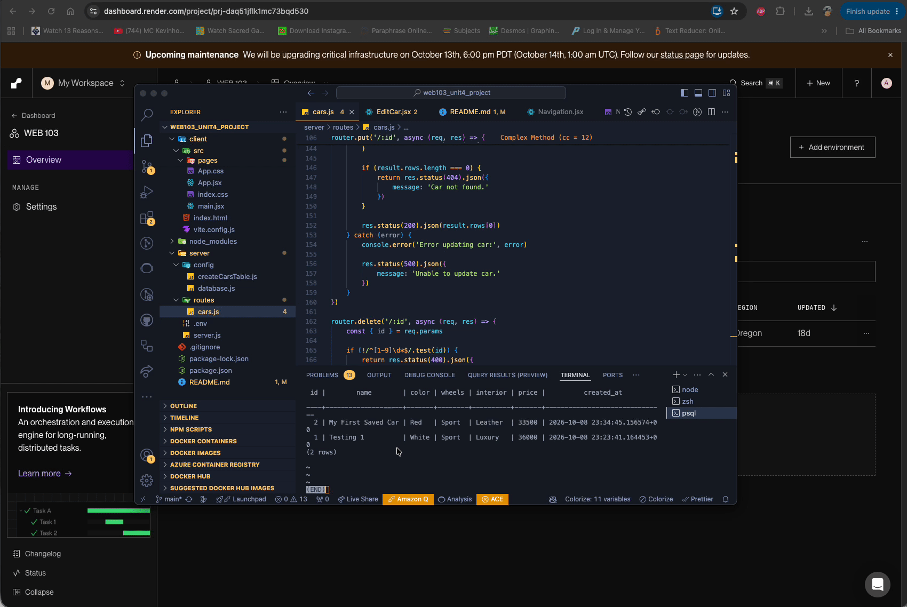

# WEB103 Project 4 - Bolt Bucket 

Submitted by: **Alston Dsouza**

About this web app: **Bolt Bucket is a full-stack car customization application where users can build their dream cars by choosing exterior colors, wheels, and interior upgrades. The app features an interactive car showroom, a live visual preview, and dynamic pricing. Users can save their customized cars to a PostgreSQL database, browse their garage, view individual car details, edit their designs, and delete saved cars.**

Time spent: **11** hours

## Required Features

The following **required** functionality is completed:

- [x] **The web app uses React to display data from the API.**
- [x] **The web app is connected to a PostgreSQL database, with an appropriately structured `CustomItem` table.**
  - [ ] **NOTE: Your walkthrough added to the README must include a view of your Render dashboard demonstrating that your Postgres database is available.**
  - [ ] **NOTE: Your walkthrough added to the README must include a demonstration of your table contents. Use the psql command `SELECT * FROM tablename;` to display your table contents.**
- [x] **Users can view multiple features of the `CustomItem` they can customize, such as exterior colors, wheels, and interiors.**
- [x] **Each customizable feature has multiple options to choose from.**
- [ ] **On selecting each option, the displayed visual icon for the `CustomItem` updates to match the option the user chose.**
- [x] **The price of the `CustomItem` changes dynamically as different options are selected.**
- [x] **The visual interface changes in response to at least one customizable feature.**
- [x] **The user can submit their choices to save the item to the list of created `CustomItem`s.**
- [x] **If a user submits a feature combo that is impossible, they receive an appropriate error message and the item is not saved to the database.**
- [x] **Users can view a list of all submitted `CustomItem`s.**
- [x] **Users can edit a submitted `CustomItem` from the list view of submitted `CustomItem`s.**
- [x] **Users can delete a submitted `CustomItem` from the list view of submitted `CustomItem`s.**
- [x] **Users can update or delete `CustomItem`s that have been created from the detail page.**

The following **optional** features are implemented:

- [x] Selecting particular options prevents incompatible options from being selected even before form submission.

The following **additional** features are implemented:

- [x] Interactive car showroom with separate Exterior, Wheels, and Interior customization panels.
- [x] Live car preview that changes color when the exterior color is selected.
- [x] Automatic price calculation based on selected upgrades.
- [x] Four exterior color options: Black, Red, Blue, and White.
- [x] Three wheel options: Standard, Sport, and Premium.
- [x] Three interior options: Cloth, Leather, and Luxury.
- [x] Validation that prevents Premium wheels from being combined with a Cloth interior.
- [x] Car details page showing the selected customization options and total price.
- [x] Edit functionality that updates saved cars in PostgreSQL.
- [x] Delete confirmation to prevent accidental removal.
- [x] Custom midnight-blue and cyan interface with a sports-car background.
- [x] REST API built with Express for creating, reading, updating, and deleting cars.

## Video Walkthrough

Here's a walkthrough of implemented required features:

### Bolt Bucket - Website Walkthrough

This walkthrough demonstrates the car customization experience, including selecting exterior colors, wheels, and interiors, viewing live pricing, creating a car, viewing saved cars, editing, and deleting cars.


### PostgreSQL - Database Walkthrough

This walkthrough is intended to demonstrate the PostgreSQL database hosted on Render and the saved car records in the `custom_cars` table.



GIF created with: **Kap for macOS**

## Technologies Used

**Frontend**
- React
- Vite
- React Router
- JavaScript
- HTML and CSS
- SVG graphics

**Backend**
- Node.js
- Express.js
- REST API

**Database**
- PostgreSQL
- Render PostgreSQL

**Version Control**
- Git
- GitHub

## Customization Options

### Exterior Colors

Users can choose from:
- Black
- Red
- Blue
- White

The car preview changes color immediately when a different exterior color is selected.

### Wheels

| Wheel Type | Additional Price |
|------------|-----------------:|
| Standard | $0 |
| Sport | $1,500 |
| Premium | $3,000 |

### Interior

| Interior Type | Additional Price |
|---------------|-----------------:|
| Cloth | $0 |
| Leather | $2,000 |
| Luxury | $4,500 |

### Pricing

The starting price for each car is **$30,000**.

The total price is calculated using:

Total Price = Base Price + Wheel Upgrade + Interior Upgrade

For example, a car with Sport wheels and Leather interior costs:

$30,000 + $1,500 + $2,000 = **$33,500**

### Customization Validation

Premium wheels cannot be combined with a Cloth interior.

If the user selects this combination, the app displays a validation message and prevents the car from being saved.

## Database

Bolt Bucket stores customized cars in a PostgreSQL database hosted on Render.

The `custom_cars` table contains the saved car configurations, allowing users to create, view, update, and delete their customized cars.

To view the saved records using an authenticated PostgreSQL terminal:

```sql
SELECT * FROM custom_cars;
```

## Notes

This project was built as part of CodePath's WEB103 Advanced Web Development course.

One of the biggest challenges was connecting the React frontend to the Express backend and ensuring that car customization data was correctly stored and retrieved from PostgreSQL.

Another challenge was implementing dynamic pricing and validation while keeping the customization interface interactive and easy to use.

I also worked on creating a custom visual design for Bolt Bucket, including an interactive showroom, a car preview that responds to exterior color changes, and a consistent midnight-blue and cyan theme.

The project helped me practice:
- Building React components and managing state.
- Creating and consuming REST API endpoints.
- Implementing CRUD operations.
- Connecting an Express backend to PostgreSQL.
- Validating user input.
- Building interactive user interfaces.
- Using Git and GitHub for version control.

## GitHub Repository

https://github.com/alstondsouza1/web103_unit4_project

## License

Copyright 2026 Alston Dsouza

Licensed under the Apache License, Version 2.0 (the "License"); you may not use this file except in compliance with the License. You may obtain a copy of the License at

http://www.apache.org/licenses/LICENSE-2.0

Unless required by applicable law or agreed to in writing, software distributed under the License is distributed on an "AS IS" BASIS, WITHOUT WARRANTIES OR CONDITIONS OF ANY KIND, either express or implied. See the License for the specific language governing permissions and limitations under the License.